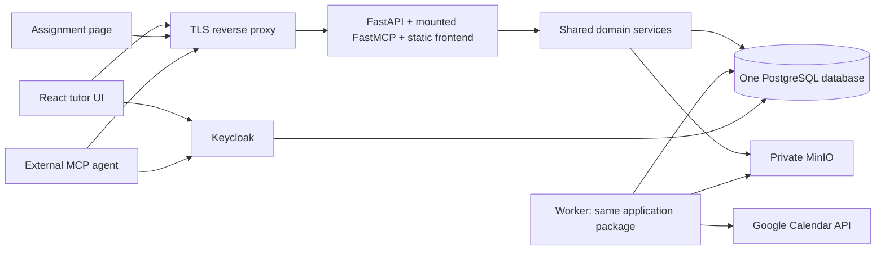

# Architecture and deployment

## Monolith and boundaries

FastAPI serves `/api/v1`, `/public/v1`, health routes and the built React frontend. FastMCP is mounted exactly at `/mcp`, with its lifespan integrated into the parent ASGI lifespan. The SPA fallback must not intercept API, MCP, OAuth discovery, or authentication routes. Use Streamable HTTP and stateless request handling where supported; durable state never lives in a web process.

Domain modules cover students, lessons, materials, tasks, homework, grading, calendar, history and jobs. HTTP routes and MCP tools are thin adapters over shared services. Services perform validation, authorization, revision checks, transactions and job insertion. Workers invoke the same services under an explicit workspace and originating operation context. No application behavior is implemented only in the UI.

Use Pydantic schemas, SQLAlchemy and Alembic for application data. Use uv with a committed lockfile for backend/worker dependencies; npm with a committed lockfile for the React/TypeScript/Vite frontend. These are future implementation deliverables, not installed packages in this documentation phase.

## One database and object store

Use exactly one PostgreSQL instance and one logical database. Put application tables in `app` and Keycloak tables in `keycloak`; separate owners, migration roles and runtime roles, with no cross-schema grants. Configure Keycloak's schema explicitly. Application services never query Keycloak tables; the identity link is verified issuer plus subject.

PostgreSQL provides relations, transactions, full-text search (`tsvector`/GIN using the simple configuration for mixed-language teaching text), durable jobs and revision history. Search results are workspace-scoped before ranking/pagination. Use no Redis, message broker, vector service or external search engine.

MinIO holds immutable objects under workspace-specific generated keys, never user-supplied paths. Database metadata is authoritative for ownership and attachment links. Originals and artifacts have explicit version records, byte lengths, MIME types and SHA-256 checksums. No public buckets. Cross-system writes use staged objects and transactionally queued finalization/cleanup; see [jobs](materials-and-jobs.md).

## Deployment and operations

One Docker Compose deployment runs reverse proxy (Caddy), application, worker, PostgreSQL, MinIO and Keycloak. App and worker share an image; the app image includes built frontend assets. Only the TLS proxy is publicly reachable; database, S3 administration and container networks remain private. Keycloak uses a separate HTTPS hostname; the app frontend and API share an origin.

Environment configuration covers public application/Keycloak URLs, database roles, S3 endpoint/bucket, Google OAuth credentials, credential-encryption key and job/upload limits. Secrets are injected at runtime, never embedded in frontend builds or committed. Key rotation retains previous decrypt keys until credentials are re-encrypted. Use named persistent volumes for PostgreSQL and MinIO.

Run application migrations once before app/worker rollout, using a migration role. Keycloak manages its own schema migrations. Stop workers for incompatible migrations. Pin images by tested versions/digests; validate backups and upgrade compatibility before changing Keycloak. Do not infer stable MCP compatibility from documentation alone.

`/health/live` checks process health; `/health/ready` checks DB connectivity/schema readiness and S3 access. Report Keycloak/Google integration health separately so a Google outage does not disable student submissions. Worker heartbeat, oldest queued job, failed jobs, conversion failures, calendar sync age and conflict count are operational signals available through structured logs and an operator status command; no new monitoring database is required.

Log request/operation/job identifiers, actor category and durations; redact tokens, credentials, document bodies and student answers. Daily database backups plus object-store backups and separate encryption-key backups are the baseline. A coordinated restore drill must verify all DB-referenced object versions exist. Backup restoration is disaster recovery, not user-level undo. Retain daily backups for 30 days; operational log retention defaults to 14 days.

## Sources and implementation gates

[FastMCP HTTP deployment](https://gofastmcp.com/docs/deployment/http) documents ASGI mounting and lifecycle integration. [Keycloak database configuration](https://www.keycloak.org/server/db) documents database/schema configuration. [PostgreSQL locking](https://www.postgresql.org/docs/current/sql-select.html) supplies queue claim primitives. Project-specific design choices are recorded in [ADRs](adr/README.md).
